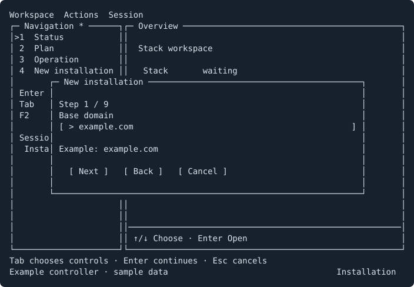
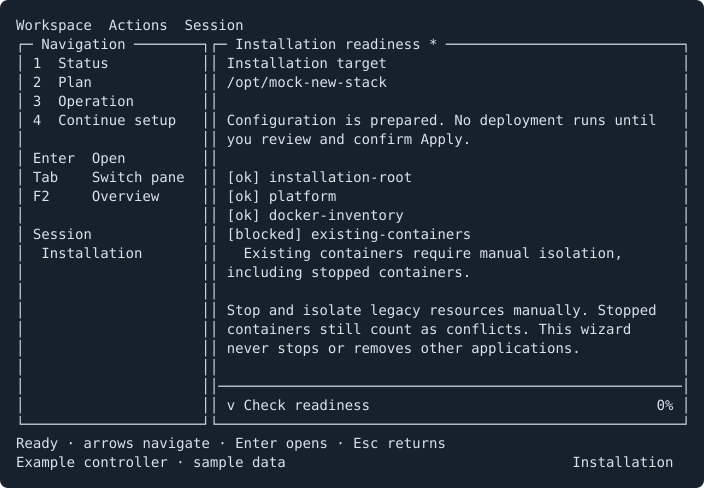
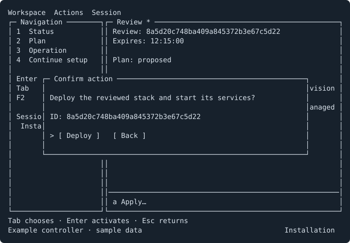
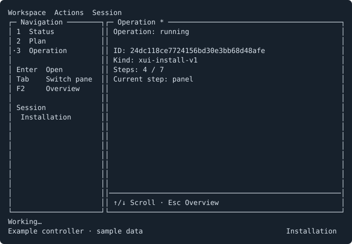
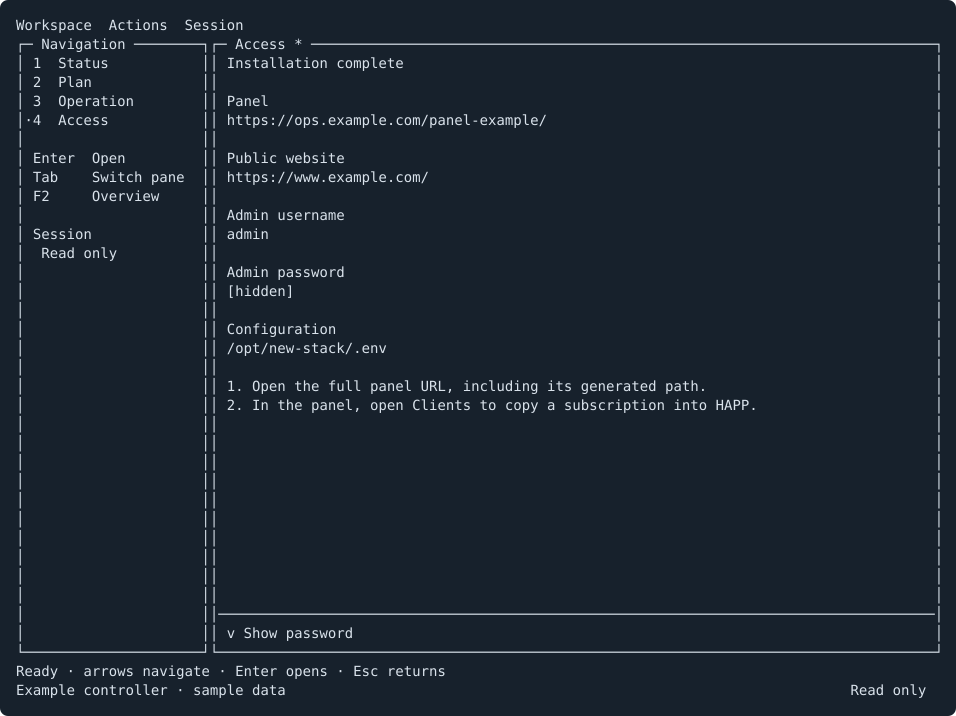

# Go controller

The controller deploys a standalone 3x-ui stack and provides a fullscreen terminal
interface. It runs on Linux amd64/arm64 without installing Go or Python. The
separate Linux/Windows manager connects over SSH for existing-host operations.

The published `v0.1.0-go.1` supports CLI installation. The installation wizard
shown below requires a wizard-enabled candidate or source build. Installation
over the SSH manager is unavailable. Adoption, optional transports, traffic nodes
and broader configuration changes use the [Python controller](running.md).

## Requirements

- A new absolute deployment path whose parent exists.
- A Linux host with root access, systemd, Docker Engine and Compose v2.
- No existing containers, volumes, custom networks or conflicting listeners.
  Stopped containers still count. Preserve and isolate an old installation
  manually before deploying; the wizard does not remove it.
- Public and panel hostnames pointing directly at this VPS, plus an ACME email.
- Inbound TCP 80 and TCP/UDP 443 allowed by the provider firewall, and outbound
  HTTPS. HTTP-01 uses public port 80. Management HTTPS defaults to loopback 2053.

The fresh stack contains Reality, Trojan HTTPUpgrade, Hysteria2, unified accounts,
subscriptions and the bundled example site. Russian destinations are allowed.
The controller does not install Docker or configure host/provider firewalls.

## Install a released controller

```bash
curl -fsSL https://raw.githubusercontent.com/keshon/3xui-reality-stack/controller-v0.1.0-go.1/scripts/install-controller.sh \
  | sudo bash -s -- --version v0.1.0-go.1
```

The bootstrap verifies the architecture-specific binary, checksum and version.
It installs `/opt/stackctl-go/v0.1.0-go.1/stackctl-go` and no application services.
Repeating it verifies the same release; changed files are not overwritten.
Checksums come from the same release publisher as the binaries.

For a wizard-enabled candidate, use its supplied executable path. Source builds
and the matching checksum manifest are described in
[controller development](internal/go-controller-plan.md#development-and-checks).
Build on the development machine; the VPS needs only the compiled controller.

## Install through the wizard

Run the wizard-enabled controller as root with the intended deployment path:

```bash
/path/to/stackctl-go tui --root /opt/new-stack
```

A new target opens setup automatically. Enter the base domain, public/panel
hostnames, certificate email, validation mode and initial usernames. Separate
usernames with spaces or commas; names must be unique and contain 1-24 lowercase
letters, digits or underscores. DNS validation needs a Cloudflare zone token;
public/panel hostnames must be directly below the base domain.

Leave the admin username and password empty to generate credentials, or enter your own.
Passwords and DNS tokens are masked. Next, Back and Cancel accept keyboard and
mouse input. Escape cancels the form. Use the terminal's paste shortcut for
tokens and passwords; in ConEmu, use Shift+Insert.



Prepare draft saves private configuration and runs readiness checks. It starts
no deployment. Correct conflicts manually, then select Check readiness. The
existing draft keeps its generated credentials and paths.



When checks pass, review the proposed effects and choose Apply. A separate
Deploy confirmation starts the installation. Escape or Back closes the
confirmation without deploying.



The operation screen displays the saved step and progress while services start,
certificates are obtained and accounts are provisioned. The controller checks
routing, native/JSON subscriptions and transfers through all three transports
before committing managed state. Test browsing from the intended client networks
after deployment.



When installation completes, Access opens with the full panel URL (including
its generated path), admin username, masked password and public website URL.
Select Show password to reveal it; leaving the page hides it again. Open the
panel's Clients page to copy a user's subscription into HAPP, then test browsing.



These examples are generated from the UI with sample data. Regeneration is
part of [development checks](internal/go-controller-plan.md#development-and-checks).

## Reopen and recover

Launch the same controller with the same root. An unapplied draft offers
Continue setup; an unfinished deployment opens Operation for explicit Resume.
Recovery uses the saved inputs. Cancel preparation is available only before
application effects and does not roll back a deployment.

After completion, Status, Plan and Operation inspect the managed installation.
Access remains in navigation and the Workspace menu every time you reopen the
TUI against the same root. It reads the applied credentials, so an unapplied
password change is never shown as the current login. SSH access to this page
requires a controller and manager that support the access capability.

Private settings are stored in `/opt/new-stack/.stack/config.json` and the
generated `/opt/new-stack/.env`. Preserve the controller's versioned directory:
the certificate-export service uses that executable's physical path.

## Existing-host TUI

The published controller can inspect an existing managed deployment:

```bash
/opt/stackctl-go/v0.1.0-go.1/stackctl-go tui --root /opt/existing-stack
```

Use the Workspace, Actions and Session menus or the navigation pane. The
controller and deployment path remain visible at the bottom. Keyboard shortcuts
are listed in Help and menus; F9 opens menus, F1 shows help, F5 refreshes and F10
exits. Navigation, dialogs and scrolling support the mouse. Unmarked directories
are not automatically adopted.
The panel-password workflow additionally needs `--experimental-password-writes`;
saving its form, reviewing the effects and confirming Apply are separate actions.
Routine user editing and general configuration changes are unavailable in this TUI.

For remote use, download the matching manager and `SHA256SUMS` from the
[release](https://github.com/keshon/3xui-reality-stack/releases/tag/controller-v0.1.0-go.1),
verify the checksum and configure SSH key/agent access through an SSH alias:

```bash
stack-manager tui --ssh my-vps --root /opt/existing-stack --controller /opt/stackctl-go/v0.1.0-go.1/stackctl-go
```

The manager uses SSH stdio and opens no management listener. It installs nothing
on the remote host. Add `--experimental-password-writes` to enable the separate
password workflow remotely.

## CLI installation

The CLI accepts private JSON instead of a form. Save `/root/fresh-install.json`
with mode 600, replacing these sample values:

```json
{
  "schema_version": 1,
  "base_domain": "example.com",
  "public_domain": "www.example.com",
  "panel_domain": "ops.example.com",
  "acme_email": "admin@example.com",
  "acme_mode": "http",
  "users": ["alice", "bob"]
}
```

```bash
controller=/opt/stackctl-go/v0.1.0-go.1/stackctl-go
"$controller" initialize --root /opt/new-stack --config-stdin < /root/fresh-install.json
"$controller" preflight --root /opt/new-stack
"$controller" plan --root /opt/new-stack --experimental-install
"$controller" review --root /opt/new-stack --experimental-install
"$controller" apply --root /opt/new-stack --experimental-install --confirm REVIEW_ID
"$controller" runtime --root /opt/new-stack
```

Replace `REVIEW_ID` with the returned identifier. Reviews expire after 15 minutes
and bind exact inputs, host state and controller identity. A changed draft needs
a new review. Initialization alone returns `can_apply: false` because it creates
configuration only. Optional `panel_user` and `panel_password` override generated
credentials. DNS-01 uses `acme_mode: "dns"` and `dns_token`.

After an interruption:

```bash
"$controller" operation --root /opt/new-stack
"$controller" resume --root /opt/new-stack --experimental-install --operation OPERATION_ID
```

Use the saved operation ID. Repeated approval returns that same operation;
resuming it is explicit. Review expiry does not prevent recovery of a started
operation.
